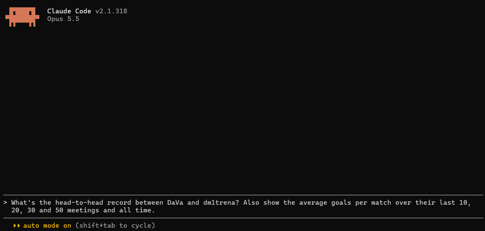
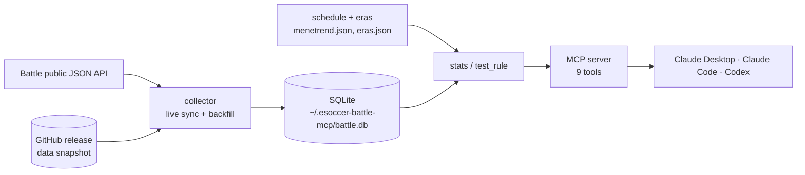

# esoccer-battle-mcp

An MCP server that lets Claude Desktop, Claude Code or Codex answer questions about **Esoccer Battle**
(the EA FC esports league with 8 and 12 minute matches). It keeps a local copy of every result since
2025-11-11 and adds new matches as they finish.

You ask in plain language: a head-to-head, an over rate per venue, whether a rule you came up with would
have made money. The assistant looks it up in the data and answers.

There are no tips, strategies, odds or bookmaker data in here. The ideas are yours; the server only
shows how they would have done.

## Install

You need [uv](https://docs.astral.sh/uv/getting-started/installation/). That is all: on first start uv
downloads Python and the server itself.

### Claude Desktop

Settings → Developer → Edit Config, then add this to `claude_desktop_config.json`:

```json
{
  "mcpServers": {
    "esoccer-battle": {
      "command": "uvx",
      "args": ["--from", "git+https://github.com/Jhanee01/esoccer-battle-mcp@v1.0.2", "esoccer-battle-mcp"]
    }
  }
}
```

Restart Claude Desktop. If it says it cannot find `uvx`, put the full path there instead (`where uvx` on
Windows, `which uvx` on macOS shows it).

### Claude Code

```
claude mcp add -s user esoccer-battle -- uvx --from git+https://github.com/Jhanee01/esoccer-battle-mcp@v1.0.2 esoccer-battle-mcp
```

### Codex

Add this to `~/.codex/config.toml`:

```toml
[mcp_servers.esoccer-battle]
command = "uvx"
args = ["--from", "git+https://github.com/Jhanee01/esoccer-battle-mcp@v1.0.2", "esoccer-battle-mcp"]
required = true
```

With `required = true` Codex waits the few seconds the server needs to start, so the tools are also
there in `codex exec` runs. If Codex says your model is not supported, pick another one with `/model`.

## First start

The server downloads a ready-made data snapshot (about 12 MB, a few seconds), then fetches the days
since the snapshot from the Battle API in the background. That takes a minute or two.

If the snapshot cannot be downloaded (no access to GitHub, a firewall), the server fetches the whole
history from the API instead. That runs in the background for 4 to 5 hours. The newest days come first,
so you can start asking questions right away.

Tools never wait for a download. Every answer says how far back the data goes and whether it is up to
date.

The data is stored in `~/.esoccer-battle-mcp/battle.db`. You can run several clients at once: one of
them collects, the others read the same database.

## Example questions

- "Head to head of Bjela vs Maki in the last 30 days. What is the over 5.5 rate?"
- "Which Stamford Bridge turnus has the highest average goals this month?"
- "Over 7.5 hit rate per venue and session since the October schedule change."
- "Test this rule: both players averaged over 3 goals scored in their last 10 matches and their previous
  meetings averaged over 7 goals. Bet over 6.5, results per month. What odds would I need?"
- "Is Ganger_29 in form? Compare their last 20 matches with the 20 before."
- "Export every San Siro match from last week to CSV."



## How it works



Every five days a GitHub Actions workflow (`snapshot.yml`) syncs the database, builds a
compressed snapshot and publishes it to the `data-latest` release. A new install is ready in
seconds instead of hours.

## Design decisions

- **Back-tests can't see the future.** `test_rule` builds each match's features only from matches
  that finished before its kick-off. A rule gets scored on what it could have known at the time.
- **Tools don't wait for data.** Collection runs in the background, and every answer says how far
  back the data goes and whether it's stale. A slow API never holds up a question.
- **Snapshot first, API second.** On first start the server downloads a ~12 MB snapshot and fetches
  only the days it's missing. If the snapshot can't be reached, it backfills everything from the
  API, newest days first, so you can start asking within minutes.
- **One collector, many readers.** Several clients can share the same SQLite file at once. A
  short-lived lease in the database decides which one collects; the others only read, and one of
  them takes over if the collector stops.
- **The schedule is data.** Sessions and turnus come from a block schedule versioned in the repo,
  not from the clock. When the league changes its schedule, a release updates the classification
  instead of matches quietly landing in the wrong session.
- **No tips included.** The server ships without tips, odds or strategies. It tells you how an idea
  would have done; the idea is yours.

## Tools

| Tool | What it answers |
|---|---|
| `player_h2h` | Two players' meetings: record, goals, O/U, BTTS, last results |
| `team_h2h` | The same for two teams |
| `market_stats` | Hit rate of an O/U, BTTS or 1X2 outcome, optionally grouped (venue, session, turnus, month, …) |
| `player_form` | A player's last N matches compared with the N before them |
| `query_matches` | The raw match list with filters (up to 500 rows) |
| `test_rule` | Back-test of your own rule: hit rate, break-even odds, baseline, results by group |
| `export_matches` | Writes the filtered matches to a CSV file you can open in Excel |
| `data_notes` | Eras, schedule changes, venues, block times. Worth reading before you look at long periods |
| `sync_status` | How fresh the data is, what it covers, recent errors, and whether a newer version is out |

All query tools take the same filters: dates or `last_days`, venue, format (8min / 12min), session
(day / afternoon / night), turnus (block of the day), kick-off time window and era.

`test_rule` computes each match's features only from matches played **before** that kick-off. The
result is what the rule would really have done at the time, not what it looks like with hindsight.

## Updating

When a new version is out, `sync_status` shows it with the release notes, and every answer carries a
short note about it. To update, change the version in your client config (for example `@v1.0.2` →
`@v1.1.0`) and restart the client. Your local data stays.

Updates also bring schedule and era changes: new leagues, new block times, a new game version. Without
them, matches after such a change can end up in the wrong session or turnus, so update when you are told
to.

## Settings

| Environment variable | Effect |
|---|---|
| `ESOCCER_BATTLE_DB` | Use this database path instead of `~/.esoccer-battle-mcp/battle.db` |
| `ESOCCER_BATTLE_NO_SYNC=1` | Do not collect; only answer from the existing database |
| `ESOCCER_BATTLE_NO_SNAPSHOT=1` | Never download the snapshot; fetch everything from the API |
| `ESOCCER_BATTLE_NO_UPDATE_CHECK=1` | Do not check GitHub for new versions |

## Data source and limits

- Results come from the public JSON API behind football.esportsbattle.com. This project has nothing to
  do with Esports Battle. The API is unofficial and may change or go away.
- Collected venues: Stamford Bridge, Old Trafford, Wembley, San Siro, Bernabeu (8 min) and Anfield,
  Etihad (12 min). Not collected: Hillsborough, and Emirates Stadium (a weekend-only "World Cup B"
  special event with 2-match tournaments, from 2026-06-19 to 2026-07-26).
- Session and turnus come from a block schedule maintained in this repo (`data/menetrend.json`), not
  from the clock. When the Battle changes its schedule, the next release fixes the classification.
- Past results do not guarantee future ones. Bet responsibly, and only where it is legal for you.

## License

MIT, see [LICENSE](LICENSE).
